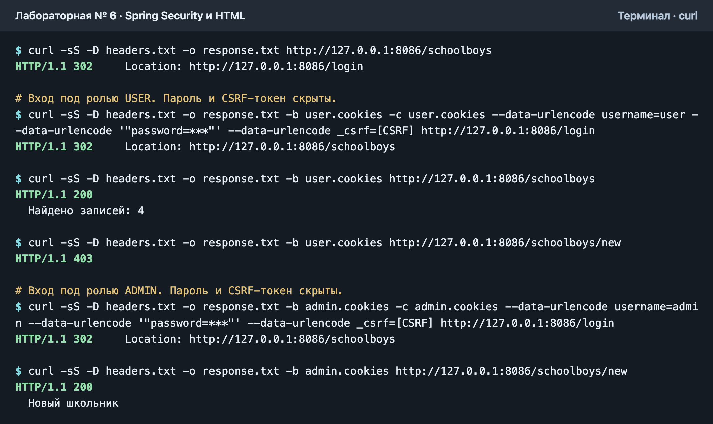

# Лабораторная работа № 6. Spring Security и HTML

## Цель работы

Добавить вход, выход и ролевое разграничение доступа в веб-приложение со школьниками. Разрешить пользователю просматривать данные, а администратору также добавлять записи.

## Архитектура проекта

- **Стек:** Java 17, Spring Boot 3.5.16, Maven Wrapper, Spring MVC, Spring Security, Thymeleaf, Spring Data JPA, Jakarta Validation.
- **СУБД:** H2 в памяти. При перезапуске восстанавливаются демонстрационные данные.
- **Основные слои:**
  - **Controller** — `SessionController` отображает страницы входа и выхода. `SchoolboyController` обслуживает список, фильтры, карточку и форму добавления.
  - **Service** — `SchoolboyService` проверяет связь школы и класса. `UserDetailsService` загружает учётную запись при входе.
  - **Repository** — `AccountRepository` ищет аккаунт по логину, а `JpaSchoolboyStore` читает и сохраняет сведения о школьниках.
  - **Security** — `SecurityFilterChain` проверяет доступ по ролям. Пароли хранятся в виде BCrypt-хешей, формы используют CSRF-токены.
- **Ключевые аннотации:** `@Configuration`, `@Bean`, `@Entity`, `@Controller`, `@GetMapping`, `@Transactional`, `@Valid`.
- **Описание моделей данных и DTO**
  - `Account` хранит логин, BCrypt-хеш пароля и роль `USER` или `ADMIN`. `Schoolboy` связан с `Address` и `SchoolClass`, который принадлежит `School`.
  - `SchoolboyData` и `AddressData` содержат поля формы. `SchoolboyFilter` передаёт критерии поиска, `SchoolboyView` передаёт карточку в шаблон. `SchoolInfo` и `ClassInfo` заполняют списки выбора.
- **Описание реализованных мапперов**
  - `Address.toData()` переводит поля сущности адреса в `AddressData`. `Schoolboy.toView()` собирает личные данные, адрес и школу в `SchoolboyData`, а затем формирует `SchoolboyView` для шаблона.
  - `JpaSchoolboyStore` использует JPQL-проекции для преобразования школ и классов в `SchoolInfo` и `ClassInfo`.
  - При входе `UserDetailsService` преобразует `Account` в `UserDetails` Spring Security с логином, хешем и ролью.

## Алгоритм работы

1. Открыть `/schoolboys`. Для гостя Spring Security перенаправляет на `/login`.
2. Войти под демонстрационной учётной записью `user` с паролем `UserLab6!`. Можно просматривать карточки и использовать фильтры. При обращении к форме добавления сервер возвращает HTTP 403.
3. Выполнить выход и войти под `admin` с паролем `AdminLab6!`. Роль `ADMIN` открывает форму добавления и позволяет сохранить запись.

## Скриншоты результатов тестирования

**Проверка гостевого доступа и разрешений ролей USER и ADMIN**

