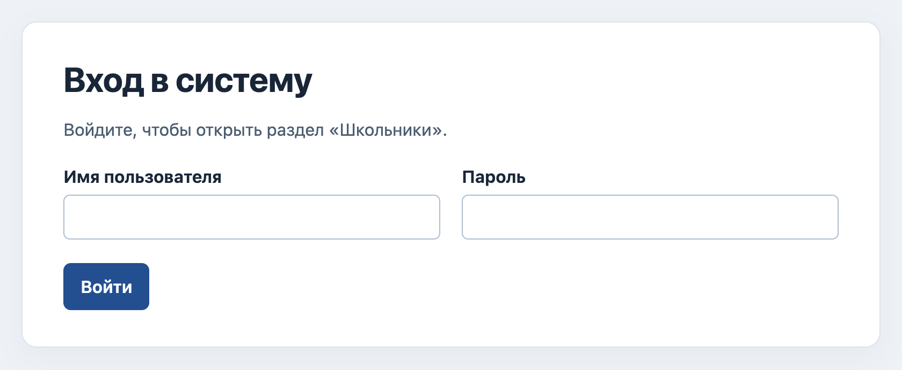
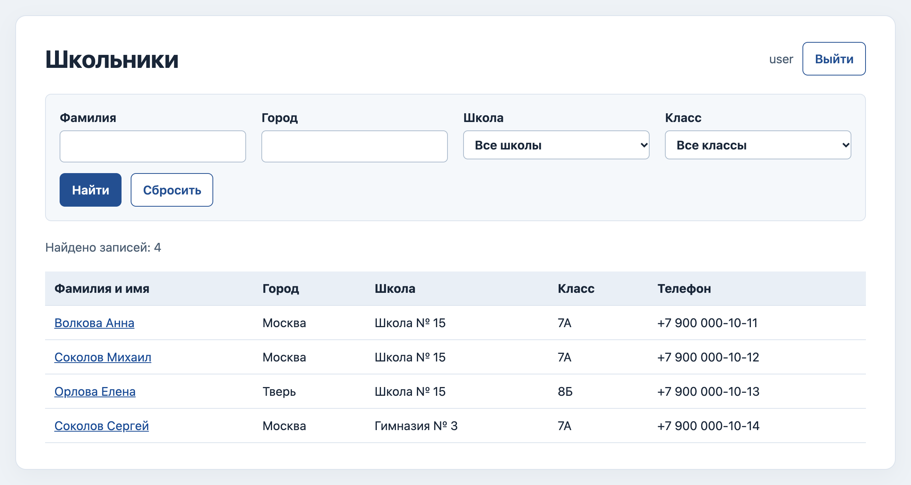
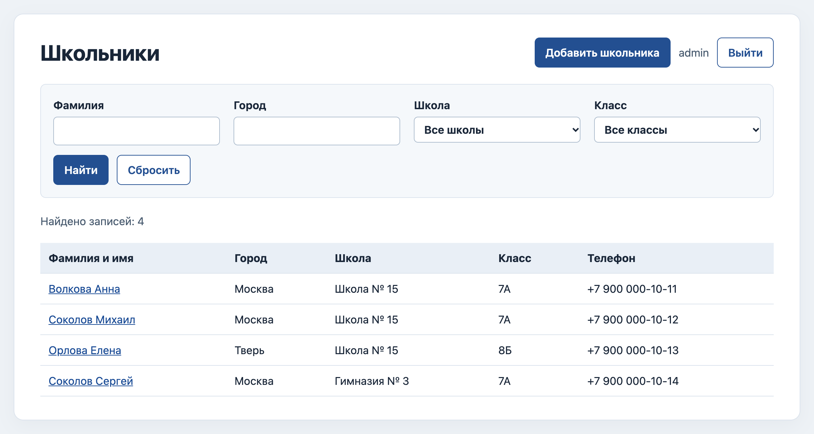
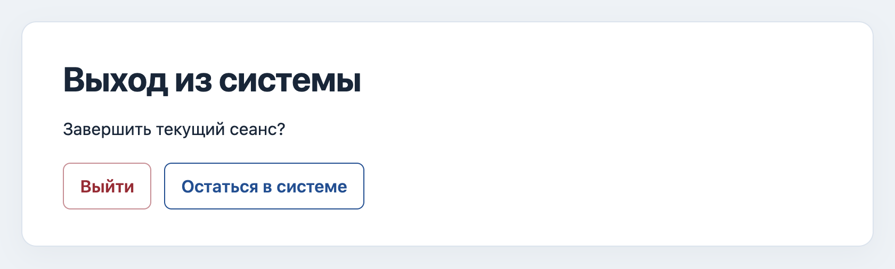

# Лабораторная работа № 6. Spring Security и HTML

## Цель работы

Защитить веб-приложение лабораторной работы № 3, добавить форму входа и разграничить доступ по ролям.

## Архитектура проекта

Стек включает Java 17, Spring Boot 3.5.16, Maven Wrapper и Spring MVC, Spring Security, Thymeleaf, Spring Data JPA, H2, Jakarta Validation.

- `SecurityFilterChain` проверяет аутентификацию и права на уровне HTTP-запросов. Thymeleaf показывает действия, доступные текущей роли.
- `UserDetailsService` загружает аккаунты из H2. Пароли в базе хранятся в виде хешей BCrypt.
- Роль `USER` может просматривать список и карточки и использовать фильтры. Роль `ADMIN` также может открыть форму и добавить запись.
- Аннотации `@Configuration`, `@Bean`, `@Entity`, `@Controller`.

## Алгоритм работы

1. Откройте приложение. Для просмотра войдите под пользователем `user` с паролем `UserLab6!`.
2. Проверьте список, карточку и фильтры. Для пользователя кнопка добавления скрыта, а прямое обращение к странице добавления возвращает HTTP 403.
3. Выполните выход через страницу подтверждения. Войдите под `admin` с паролем `AdminLab6!` и добавьте школьника.
4. Формы входа, выхода и добавления используют CSRF-токен. Указанные аккаунты предназначены для демонстрации на локальном сервере.

## Запуск в IntelliJ IDEA

1. Откройте папку с файлом `pom.xml` в IntelliJ IDEA и дождитесь импорта Maven.
2. В **File → Project Structure → Project SDK** выберите JDK 17, если среда ещё не выбрала его.
3. Выберите конфигурацию **Лабораторная 6** и нажмите **Run**. Откройте [страницу приложения](http://127.0.0.1:8086/schoolboys).

Данные H2 находятся в памяти. После перезапуска восстанавливаются демонстрационные записи.

Для проверки проекта из терминала выполните `./mvnw clean verify`.

## Скриншоты работы приложения

**Форма входа**

**Список от имени пользователя**

**Список от имени администратора**

**Подтверждение выхода**

